<div align="center">




</div>

## About

I teach networking, cybersecurity and AI security through hands-on laboratories. My aim is simple: students should be able to build the systems they study, and understand how to defend them.

I trained as a telecommunications engineer and spent three years advising clients on Cisco infrastructure before moving into teaching. That mix of industry practice and classroom work shapes how I design labs: every exercise begins with a problem engineers actually face, such as a misconfigured router, a weak firewall rule or a program that fails on an edge case.

I now lead practical sessions at university level while completing my Master's degree. My current interest is the security of machine learning systems, and how to prepare students to work on it.

## Research interests

- **AI security.** How machine learning systems fail, and practical ways to harden them.
- **Network security.** VLAN security, intrusion detection, firewalls and evasion techniques.
- **Malware analysis and cryptography.** Understanding threats in order to teach defence.
- **Routing and network design.** RIP, EIGRP, OSPF and BGP, with IPv4 and IPv6.
- **Computing education.** Laboratory design, practical assessment and feedback.

## Teaching

Laboratory instruction across eight courses.

| Course | Focus |
|---|---|
| Data Communication and Networking | Routing protocols, IPv4 and IPv6, VLANs, DHCP, DNS, SSH, TCP and UDP |
| Cybersecurity | Ethical hacking, cryptography, malware analysis, defensive thinking |
| AI Security | Threats to machine learning systems and how to harden them |
| Operating Systems | Processes, memory and scheduling, explored on live systems |
| Computer Programming | Problem-solving in Python and C++ |
| RISC-V Assembly | How software meets hardware, one instruction at a time |
| Digital Logic Design | Gates, circuits and the logic beneath every processor |
| ICT Applications | Practical digital skills for students across disciplines |

<details>
<summary><b>Teaching approach</b></summary>
<br>

- **Learn by building.** Students configure, program and test real systems in the lab. Theory arrives through the problem, not before it.
- **Assess by doing.** Progress is measured through lab assignments, projects and practical exams, with individual feedback at each stage.
- **Keep materials current.** I co-design exercises with faculty and update material as curricula and industry standards change, as I did when revising CCNA content after Cisco's certification updates.
- **Support each student.** I mentor students individually toward their coursework and certification goals.

</details>

## Lab bench

Worked examples from the labs I run, grouped by what I teach. A README cannot run code, so these show real inputs and outputs. Interactive versions of the tools are on my portfolio site: **[https://YOUR-GITHUB.github.io](https://github.com/engrfayyazhussainsahito/engrfayyazhussainsahito)**

<details>
<summary><b>Networking:</b> subnetting, IPv6, routing metrics, ports</summary>
<br>

**Subnet calculator.** `192.168.10.0/26`

| Field | Value |
|---|---|
| Subnet mask | 255.255.255.192 |
| Network | 192.168.10.0 |
| First host | 192.168.10.1 |
| Last host | 192.168.10.62 |
| Broadcast | 192.168.10.63 |
| Usable hosts | 62 |

**IPv6 expander.** `2001:db8::1`

```
Full:     2001:0db8:0000:0000:0000:0000:0000:0001
Shortest: 2001:db8::1
Type:     Documentation (2001:db8::/32)
```

**Routing protocols at a glance**

| Protocol | Type | Metric |
|---|---|---|
| RIP | Distance-vector | Hop count, maximum 15 |
| EIGRP | Advanced distance-vector (DUAL) | Composite: bandwidth and delay |
| OSPF | Link-state (Dijkstra SPF) | Cost: reference bandwidth / link bandwidth |
| BGP | Path-vector | AS-path length, then policy |

**Protocols and ports**

| Port | Service | Transport |
|---|---|---|
| 22 | SSH | TCP |
| 23 | Telnet | TCP |
| 53 | DNS | UDP and TCP |
| 67 / 68 | DHCP server / client | UDP |
| 179 | BGP | TCP |
| 443 | HTTPS | TCP |
| 520 | RIP | UDP |
| n/a | OSPF, EIGRP | IP protocols 89 and 88 |

</details>

<details>
<summary><b>Security:</b> hashing and password entropy</summary>
<br>

**Hash generator.** SHA-256 of `hello`

```
2cf24dba5fb0a30e26e83b2ac5b9e29e1b161e5c1fa7425e73043362938b9824
```

The same input always gives the same hash, and changing one character changes the whole result.

**Password entropy.** Entropy = length × log₂(size of character pool), assuming random characters.

| Password type | Pool | Entropy | Full search at 10 billion guesses/s |
|---|---|---|---|
| 8 random lowercase letters | 26 | 37.6 bits | about 21 seconds |

Passwords built from common words or patterns are weaker than this estimate suggests.

</details>

<details>
<summary><b>Systems:</b> CPU scheduling</summary>
<br>

**Scheduling simulator.** Burst times `5 3 8 6` for P1 to P4, all arriving at time 0. Turnaround = completion time, waiting = turnaround − burst.

| Algorithm | Order | Avg waiting | Avg turnaround |
|---|---|---|---|
| FCFS | P1, P2, P3, P4 | 7.25 | 12.75 |
| SJF (non-preemptive) | P2, P1, P4, P3 | 6.25 | 11.75 |

SJF lowers the average waiting time here because short jobs no longer queue behind long ones.

</details>

<details>
<summary><b>Hardware:</b> number bases, logic gates, RISC-V decoding</summary>
<br>

**Number base converter.** Decimal `202`

```
Binary:      1100 1010
Hexadecimal: CA
Octal:       312
```

**Logic gate explorer.** XOR truth table

| A | B | Y |
|---|---|---|
| 0 | 0 | 0 |
| 0 | 1 | 1 |
| 1 | 0 | 1 |
| 1 | 1 | 0 |

**RISC-V (RV32I) instruction decoder**

| Hex | Format | Assembly |
|---|---|---|
| `0x00A28293` | I-type | `addi t0, t0, 10` |
| `0x00812503` | I-type (load) | `lw a0, 8(sp)` |
| `0xFEB50EE3` | B-type (branch) | `beq a0, a1, -4` |

</details>

## Experience

<details open>
<summary><b>Lab Instructor</b>, Muhammad Ali Jinnah University. Dec 2025 to present</summary>
<br>

- Lead lab sessions and co-design exercises and assignments with faculty.
- Give individual feedback and assess students through projects and practical exams.
- Maintain lab equipment and software; contribute to curriculum improvements and departmental meetings.

</details>

<details>
<summary><b>Trainer</b>, Cisco Networking Academy, Karachi. Jul 2024 to Nov 2024</summary>
<br>

- Built and taught CCNA courses with lectures, labs and assessments.
- Ran hands-on labs in Cisco Packet Tracer and on real equipment.
- Mentored students toward certification and updated materials as Cisco changed its syllabus.

</details>

<details>
<summary><b>Technical Consultant</b>, ICT Global Pvt, Islamabad. Aug 2021 to Nov 2024</summary>
<br>

- Matched client requirements to Cisco solutions and delivered demonstrations and briefings.
- Supported sales teams with technical answers and proposals.
- Wrote solution briefs and client reports; fed customer needs back to the product team.

</details>

<details>
<summary><b>Intern</b>, Pakistan Broadcasting Corporation, Karachi</summary>
<br>

- Operated TV and radio production equipment and worked across teams on live events.

</details>

## Education and academic training

| Program | Institution | Period |
|---|---|---|
| M.S. Computer Science | Muhammad Ali Jinnah University, Karachi | Spring 2025 to present |
| B.E. Telecommunications Engineering | Faculty of Engineering and Technology, University of Sindh | Completed |
| CCNA: Routing and Switching | Cisco Networking Academy | Short course |

**Professional certifications**

- **Security:** Certified Ethical Hacker (CEH). Penetration Testing and Ethical Hacking. Ethical Hacking: Cryptography. Ethical Hacking: Evading IDS, Firewalls and Honeypots. Advanced Malware Analysis: Redux. Ethics in Cybersecurity. Cybersecurity Foundations. Career Essentials in Cybersecurity (Microsoft and LinkedIn).
- **Networking:** CCNA, Cisco Certified Network Associate (SMIT).
- **Programming:** Advanced Algorithmic Thinking with Python.

**Technical skills:** Python, C++, RISC-V Assembly, HTML, CSS, JavaScript, machine learning, routing protocols (RIP, EIGRP, OSPF, BGP), IPv4 and IPv6, router and switch configuration, VLAN security, DHCP, DNS, Telnet, SSH, TCP and UDP.

## Right now

Teaching in the lab, studying for my Master's, and learning how to secure AI.

<div align="center"><sub>© Fayaz H. Sahito. Karachi, Pakistan.</sub></div>
